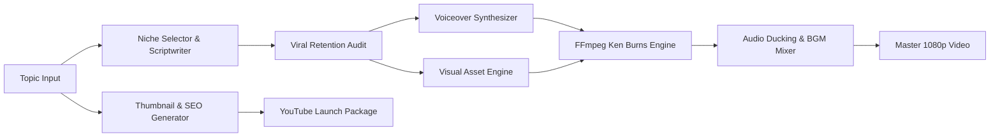

# AutoVideo AI

## Autonomous 100% Free Long-Form Video Production Engine

[](https://www.python.org/)
[](LICENSE)
[](https://ollama.com)
[](https://github.com/rany2/edge-tts)
[](https://ffmpeg.org/)
[](https://github.com/mightyalok00/autovideo-ai)

**Transform raw topics into broadcast-quality 1080p YouTube documentaries, explainers, and lore videos with zero paid API subscriptions.**

[Key Features](#key-features) • [Quick Start](#quick-start) • [Pipeline Architecture](#pipeline-architecture) • [Supported Niches](#supported-niches) • [Configuration](#configuration)

---

## Overview

AutoVideo AI is a self-directing video production engine designed for content creators, educators, and media automation workflows.

Unlike tools that rely on expensive SaaS subscriptions, AutoVideo AI runs a unified, zero-cost pipeline on your local hardware:

1. **Scriptwriting:** Directs dynamic multi-scene narrative scripts via local Ollama models (`llama3.2`, `mistral`, `deepseek-r1`) with cloud fallback options.
2. **Audio Synthesis:** Narrates scripts using Microsoft Edge Neural Speech for natural human pacing and inflection.
3. **Visual Production:** Generates tailored scenes using Pollinations AI coupled with authentic archival imagery from Wikimedia REST.
4. **Cinematic Assembly:** Executes lossless FFmpeg rendering with Ken Burns pan/zoom motions, audio ducking, and ambient background music.
5. **YouTube Packaging:** Automatically produces 1280x720 high-CTR thumbnails, timestamped chapter markers, SEO titles, and tags.

---

## Key Features

| Capability | Implementation | Benefit |
| :--- | :--- | :--- |
| **Local Intelligence** | Ollama (`llama3.2`, `mistral`, `deepseek-r1`) | 100% offline, zero token fees, unlimited length |
| **Neural Voiceover** | Microsoft Edge Neural TTS (`edge-tts 7.3.1`) | Human-sounding cadence with custom pitch/rate controls |
| **Archival & AI Imagery** | Pollinations AI + Wikimedia REST API | Zero-rate-limit visuals with authentic historical context |
| **FFmpeg Video Assembler** | Lossless Concat Demuxer + Ken Burns FX | 60 FPS / 1080p rendering without RAM bottlenecks |
| **Sound Design** | FFmpeg Audio Ducking Filter Graph | Ambient background score ducked under voice narration |
| **Packaging Engine** | Pillow High-Contrast Typographic Overlay | 1280x720 click-optimized thumbnails and SEO metadata |
| **Web Dashboard** | Native Python HTTP/REST Studio | Accessible at `http://localhost:8501` without complex frameworks |

---

## Pipeline Architecture



---

## Quick Start

### 1. Prerequisites

- Python 3.10 or higher
- FFmpeg installed and added to system `PATH`
- (Recommended) [Ollama](https://ollama.com) for local, private script generation:

```bash
ollama run llama3.2
```

### 2. Installation

Clone the repository and install required Python packages:

```bash
git clone https://github.com/mightyalok00/autovideo-ai.git
cd autovideo-ai
pip install -r requirements.txt
```

### 3. Launch the Web Studio

```bash
python app.py
```

Open `http://localhost:8501` in your browser to access the interactive web dashboard.

### 4. Or Run Headless from CLI

```bash
python -c "from autonomous_agent import run_agent; run_agent('The Hidden Secrets of Deep Space', duration_minutes=3, niche_id='space')"
```

---

## Project Structure

```text
autovideo-ai/
├── app.py                  # Local Web Studio server & REST endpoints
├── autonomous_agent.py     # 6-Stage Autonomous Director production loop
├── agent_brain.py          # Viral retention rules & quality audit engine
├── script_generator.py     # Multi-provider scriptwriter (Ollama, OpenRouter, Niche Engine)
├── voiceover.py            # Microsoft Neural Voice generator (edge-tts 7.3.1)
├── visuals_fetcher.py      # AI generation (Pollinations) & Archival fetcher (Wikimedia)
├── video_assembler.py      # FFmpeg pan/zoom builder, concat demuxer & BGM mixer
├── thumbnail_generator.py  # High-CTR 1280x720 thumbnail designer with typography overlays
├── seo_optimizer.py        # YouTube title variants, chapter timestamps & tags
├── niche_engine.py         # 10 Specialized niche templates & keyword discoverer
├── config.py               # Paths, video dimensions, voice settings & model configs
└── assets/music/           # Atmospheric ambient background soundtrack
```

---

## Supported Niches

AutoVideo AI includes specialized production templates, pacing heuristics, and visual prompts for 10 high-growth YouTube niches:

1. History & Ancient Civilizations (Stoicism, Rome, Forgotten Lore)
2. Deep Space & Cosmic Mysteries (James Webb discoveries, Black Holes)
3. True Crime & Dark Unsolved Mysteries (Cold cases, Interrogations)
4. Stoicism & Dark Psychology (Marcus Aurelius, Mental resilience)
5. Finance & The Secrets of Wealth (Economic collapse, Tycoons)
6. AI, Tech & The Future (Singularity, Neural networks, Robotics)
7. Horror, Cryptids & Folk Legends (Hauntings, Urban lore)
8. Biohacking & Extreme Human Potential (Longevity, Neuroscience)
9. Geopolitics & Shadow Wars (Global conflict, Intelligence agencies)
10. Gaming Lore & Easter Eggs (Deep video game mythologies)

---

## Configuration

AutoVideo AI runs out-of-the-box with zero configuration required.

To optionally integrate external cloud providers or custom settings, copy `.env.example` to `.env`:

```ini
# Optional Cloud LLM Keys (Ollama runs locally for free without keys)
OPENROUTER_API_KEY=your_key_here
GEMINI_API_KEY=your_key_here
GROQ_API_KEY=your_key_here
PEXELS_API_KEY=your_key_here

# Local Ollama Endpoint (Default: http://localhost:11434)
OLLAMA_URL=http://localhost:11434
```

---

## Contributing

Contributions are welcome! Please follow these steps:

1. Fork the Project
2. Create your Feature Branch (`git checkout -b feature/AmazingFeature`)
3. Commit your Changes (`git commit -m 'Add AmazingFeature'`)
4. Push to the Branch (`git push origin feature/AmazingFeature`)
5. Open a Pull Request

---

## License

This project is licensed under the MIT License - see the [LICENSE](LICENSE) file for details. Free for personal, academic, and commercial content automation.
